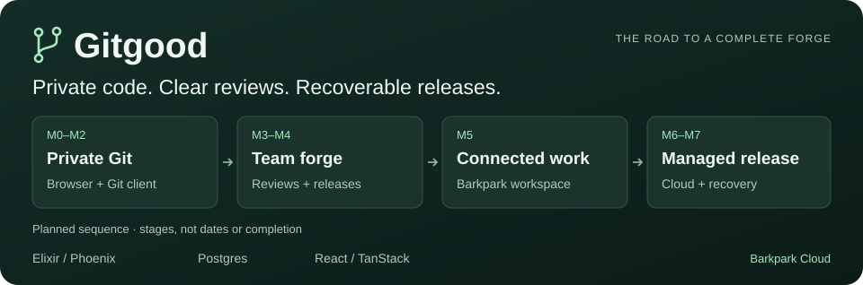
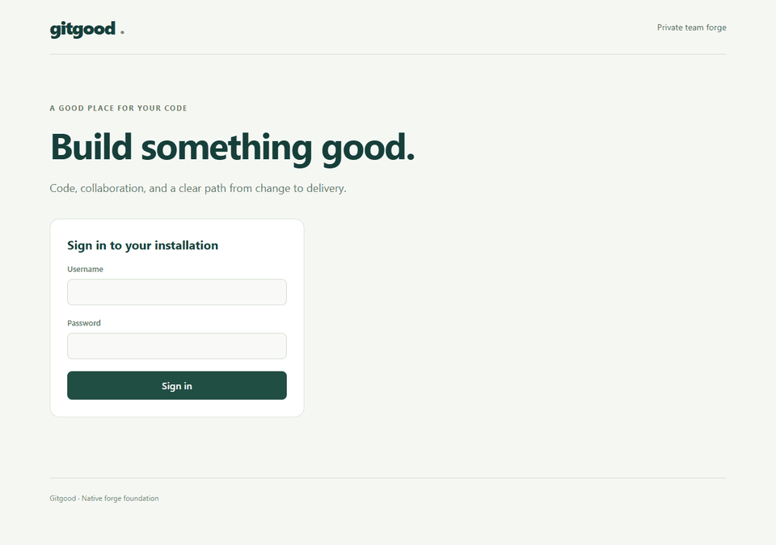

[](docs/ROADMAP.md)

# Gitgood

**A private home for your team's code, reviews, and releases.** Gitgood connects changes to the tasks, specifications, and evidence behind them. It has a native Elixir/Phoenix backend, Postgres, standard Git, and a React/TanStack interface. Barkpark connects the workspace; Barkpark Cloud is the planned managed deployment path.

**Development preview.** The local app includes private repositories, HTTPS and SSH Git, browsing, pull requests, reviews, protected merges, and basic releases. Complete journey acceptance, native installation and recovery integration, and managed Cloud deployment remain unfinished. There is no Gitgood product release yet.

[Start locally](docs/DEVELOPMENT.md) · [Progress snapshot](docs/STATUS.md) · [Roadmap](docs/ROADMAP.md) · [Documentation](docs/README.md)

## See the interface

[](docs/WEB-TOUR.md)

Actual development screens with **synthetic sample data**. [Open the visual tour](docs/WEB-TOUR.md) for full-size screenshots, a browser video and an ASCII walkthrough. These captures show the current frontend; they do not establish backend or release readiness.

## Follow the project

| Your question | Start here |
|---|---|
| What are we building, and where does the first release stop? | [Product scope](PRODUCT.md) |
| What is assessed, what is missing, and what comes next? | [Progress snapshot](docs/STATUS.md) → [Delivery sequence](docs/EXECUTION.md) |
| How do I run it and find the relevant code? | [Development guide](docs/DEVELOPMENT.md) → [Code map](docs/CODEBASE.md) |
| How do the parts fit together? | [Architecture](docs/architecture.md) |
| What makes a feature complete? | [User journeys](JOURNEYS.md) → [Quality criteria](QUALITY.md) |

The [private delivery ledger](https://guerrilla.barkpark.cloud/w/gitgood/p/delivery/studio) owns live work and blockers. The snapshot is a dated observation; draft PRs are work in progress, and passing component tests do not mean a whole journey is accepted. The [full Gantt](docs/images/roadmap.svg) shows delivery order and where capabilities appear, without promising calendar dates.

## Find your way around

- [apps/forge](apps/forge/README.md): API, permissions, Git operations, and durable records.
- [apps/web](apps/web/README.md): browser interface and its server-side API connection.
- [docs](docs/README.md): guides, scope, decisions, and implementation references.
- [deploy](deploy/README.md): the deployment contract; [tools/deployment](tools/deployment) contains native operation tools.
- [evidence](evidence/README.md): reporting inputs and verification rules.

## Contribute and keep it readable

Follow [the contribution guide](CONTRIBUTING.md). Agents can implement, verify, and merge passing work under [the autonomous progression policy](AUTONOMY.md); oversight comes from readable changes and traceable evidence.

The source repository is public, and CI uses disposable GitHub-hosted Ubuntu machines. Public visibility does not add a software license; [D01](docs/decisions/D01.md) records the decision. Use [private vulnerability reporting](SECURITY.md) for security findings.

For documentation and reporting changes, use Node 22 with OpenSSL on `PATH` and run these from the repository root. They need no npm install; they do not run the application test suites.

```sh
npm run generate
npm run check
```

<!-- whats-new:start -->
## What's new

**Unreleased — development.** 178 development changes are recorded in the [changelog](CHANGELOG.md#unreleased). No Gitgood application release has been published.
<!-- whats-new:end -->
