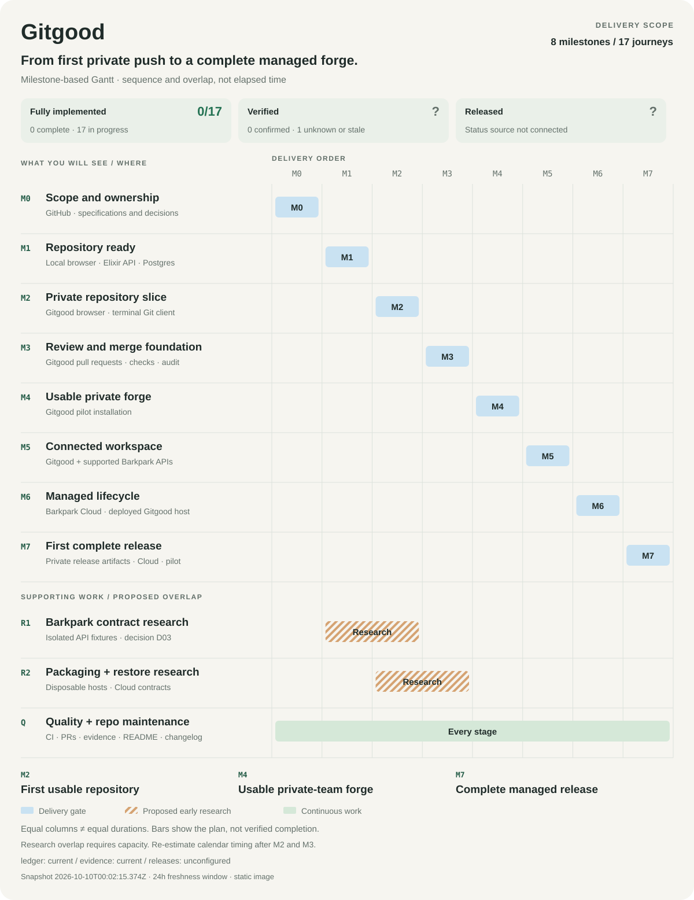

[](docs/ROADMAP.md)

# Gitgood

A native forge connecting requirements, tasks, code review, evidence, and releases.

[Full-size Gantt](docs/images/roadmap.svg) · [Journey evidence map](docs/images/journey-evidence.svg) · [Milestone exit criteria](docs/ROADMAP.md) · [Journey specifications](JOURNEYS.md)

**Native development is underway.** This checkout contains a Phoenix/Postgres private repository foundation, a TanStack web interface, specifications and reporting checks. See [forge setup](apps/forge/README.md) and [web setup](apps/web/README.md). Native HTTPS/SSH Git, supported bundle import, commit browsing, pull requests, reviews, checks, protected merges and [basic private releases/assets](docs/implementation/releases.md) are implemented with development verification. The [private Gitgood delivery ledger](https://guerrilla.barkpark.cloud/w/gitgood/p/delivery/studio) now owns live implementation status. Evidence/release ingestion and managed deployment remain unfinished; no Gitgood product release is established. See the [tracking contract](docs/TRACKING.md) for refresh and freshness limits.

**Autonomous progression.** Agents resolve decisions, implement, verify, merge, and advance milestones without human acceptance. Current evidence governs each transition. See [AUTONOMY.md](AUTONOMY.md) for the operating policy and the distinction between active agent work and future unattended automation.

**Foundation run delivered.** The [run finish record](docs/RUN-72H-FINISH.md) maps implemented behavior to tests, candidate identities and remaining scope. [Production artifact instructions](docs/deployment/production.md) reproduce the copied Elixir/TanStack installation and readiness experiment.

<!-- whats-new:start -->
## What's new

**Unreleased — development.** Added a time-boxed first implementation run targeting the running foundation and private create/clone/push/browse slice, with observed environment constraints, verification checkpoints, and recovery rules. Added a 72-hour implementation proposal covering the private repository slice, review/check/merge foundations, interruption recovery, and clean-target packaging, with evidence-based daily targets. Delegated project progression to agents and replaced human acceptance gates with recorded evidence-based verification across decisions, milestones, merges, and releases. Added private per-account Barkpark connection APIs with source-verified scoped service identities, separate-key authenticated credential encryption, generation-safe rotation/disconnect and durable request receipts; complete linked-workspace workflows remain pending. Added private Barkpark account settings with credential-input clearing, current-state reconciliation after historical receipts, unavailable-read hiding and old-account completion guards. Added an origin-pinned, bounded Barkpark HTTP adapter with separate request capacity, TLS and wire checks, plus real private-source permission and idempotency experiments; linked-workspace journeys remain pending. Added durable Paper return-link responsibility with encrypted immutable source requests, bounded attempts, visible pause/retry, actual write receipts and separately attributed source observation. Added private tag/commit releases with transactional checksummed assets, actual commit ranges, reviewed-note publication, safe retries, retained corrections/withdrawals and native immutable tag pushes. Bounded evidence history to 20 records and 25 events per record per response, with authorized navigation and whole-history latest-result state. NUL-containing evidence text now refuses before database storage; retained records and artifact custody are unchanged. Bound managed Git packing to two threads so many-core hosts retain functional HTTPS/SSH transfer within the existing worker memory ceiling. Bound concurrent browse requests with four active readers, eight waiting callers and a five-second admission deadline; temporary Git capacity failures return retryable service errors. Sequence repository branch and selected commit reads, and admit pull-request revision reads through the same bounded queue; preserve retryable capacity refusals without raising resource limits. Align each isolated CI worker's private cgroup namespace with its delegated mount and make owned job directories traversable, preserving actual backup writer-exclusion checks. Declare and verify the native Python and Git executable paths required by copied-production interrupted-writer recovery in Linux CI. Install and verify OpenSSH client tools in required Linux CI instead of assuming a prepopulated runner image; retain actual SSH authorization and transport checks. Replaced the shared production proxy login bucket with authenticated edge/socket client addresses, preserving per-address limits and rejecting forged forwarding assertions. Navigate repository cards, files, history and pull-request lists through the web router while retaining shareable URLs and disabling speculative reads. Added private commit browsing with stable URLs, branch selection, file tree, safe text previews, history and bounded diffs. Preserve exact evidence requests in encrypted native custody across reload, navigation and panel unmount, with actor-only recovery, separate receipt acknowledgement and safe retirement. Filter private headers from Caddy runtime errors and cancelled-stream warnings as well as access evidence. Disable expanded config persistence and require actual failure-path privacy checks in copied-production verification. Preserve the original connection-generation refusal when retrying a saved evidence draft, retaining its responsibility without poisoning the surrounding database transaction or creating a new assessment. Preserve the original browser evidence request across lost responses and Source revision changes, with explicit retry and native receipt validation. Resolve exact actor-bound evidence receipts before validating new creation inputs. Legacy protected bytes keep their checksum; changed bodies conflict and revoked native writers cannot replay receipts. Converted the top README roadmap to a milestone Gantt showing delivery surfaces and proposed research overlap; retained the detailed journey evidence map as a separate generated view. Added a real-client compatibility experiment for Git protocols, shallow ancestry, separate submodule credentials, signed object preservation and explicit LFS/partial-clone/SHA256 hosting limits; production verification includes exact ref/gitlink persistence. Renamed the project from Gitpark to Gitgood, including the private GitHub repository, documentation, package metadata, roadmap SVG, and maintenance variable. Expose coordinated encrypted native installation export and inspect its authenticated Git/configuration/database inventory without connecting to the live database; removal remains unfinished. Route required planning and forge jobs to the measured isolated ephemeral Linux runner after real GitHub dispatch proof, verifying the build platform and installer image identity while preserving tests and full production recovery. Connected the private Gitgood delivery ledger to a scoped authenticated implementation-status collector with requirement binding, retained observation history and failed-read preservation; evidence/release ingestion and unattended publishing remain pending. Inspect digest-pinned Linux native artifacts without extraction or execution, checking bounded paths, matching build identities, migrations and runtime platform before installation staging. Stage inspected native code under private custody with independent file hashes, retained interrupted requests and atomic publication that cannot replace existing targets. Added durable native links to Barkpark tasks and Paper specifications, per-viewer source reads, private change-page context, and original operation receipts that survive removal and replay. Document the measured native rootless CI boundary and a pinned runner build recipe, preserving failed emulated/minimal-image results and requiring actual job conclusions. Added immutable native evidence attached to linked task criteria and exact source/Git revisions, checksummed private text artifacts, explicit reassessment history and unavailable-artifact events; full J11 acceptance remains under verification. Added a runnable Phoenix/Postgres private repository foundation and TanStack web interface with local identities, revocable sessions, backend membership checks, durable idempotent creation and recovery tests. Added scoped and revocable Git credentials, authenticated native smart HTTP clone/push/fetch, protected main enforcement, durable push records and bounded subprocess supervision. Build digest-pinned PostgreSQL 18.4 server and recovery clients in the isolated Ubuntu runner, preserving exact recovery versions and the same-OS database locale profile. Recorded the completed native foundation run with criterion-level observations, exact candidate/runtime evidence, clean-start instructions, integration references and remaining private-forge/Cloud milestones. Added PostgreSQL-owned Ed25519 account keys, browser registration/revocation, native OTP SSH Git transport, host fingerprints and clone URLs, with shared authorization/push recovery and real-client interruption checks. Retain successive native upgrade journals under one installation lock, requiring terminal recovery or completion and preserving interrupted reservations without claiming activation. Persist private native upgrade responsibility with fixed stages, process ownership, explicit interrupted-action reconciliation and read-only status without claiming activation. Exclude surviving runtime writers from production migration and Linux replacement admission, validating the new startup lineage while retaining first-install migration support. Implemented coordinated encrypted offline recovery with complete-process exclusion, database locale compatibility, exact restore retry and preserved interrupted Git locks; supported recovery acceptance remains under verification. Added opaque native change landing addresses with permission-bound resolution and validated sign-in return targets, preparing source links without exposing repository names in their URLs. Add a checksum-bound warm-read observer with independent actors, retained failures and concurrent outsider checks; actual capacity measurements remain pending. Define the initial bounded pilot repository, independent concurrent actors, cache and network phases, and performance targets before measurement. Product scope, 17 journey specifications, delivery milestones, repository routines, and a generated roadmap are available. Added permission-filtered native search and activity, opaque collaboration links, shared browser access invalidation and audited owner controls for team membership; corrected merge crash proof to bind the clean source candidate and requirement. Private GitHub repository FRIKKern/gitgood established with planning verification on pushes and pull requests, current pinned GitHub Actions, and an explicit Ubuntu 24.04 runner. Added copied production Elixir/TanStack artifacts, clean commit/spec build identity, migration/bootstrap entry points, dependency/storage readiness and an isolated full-workflow persistence experiment. Added same-repository pull requests, exact-line comments and reviews, scoped check providers, current branch policy and atomic protected fast-forward merges with durable recovery markers. Added creator-owned full Git bundle import with bounded streaming intake, durable replay/provenance, atomic branches and tags, recovery markers and browser/native-client verification. Capture current pull-request branch revisions in bounded Git reads, bind diffs to their immutable objects and require matching browser context before review actions. Redesigned the README roadmap with journey-level status, milestone dependencies and exit criteria, separate progress summaries, and light/dark palettes. Disabled automatic distributed Erlang registration for single-host releases after a real concurrent Windows/Linux node collision; added populated/history-only Barkpark migration refusal and a fresh-VM encrypted-account retention fixture. Target the protected membership migration in populated downgrade verification, check complete audit retention and restore the current schema before a fresh-process check. Select copied-production Caddy fixture ports only after both TCP and UDP bind successfully. Bounded retries preserve unrelated listeners and retain the HTTP/3 listener instead of dropping its protocol. No Gitgood application release has been published.
<!-- whats-new:end -->

## Start here

1. Read [Product scope](PRODUCT.md) and [Architecture](docs/architecture.md).
2. Follow [Execution order](docs/EXECUTION.md); open decisions are explicit.
3. Use [Journeys](JOURNEYS.md) and [Quality rules](QUALITY.md) to judge completion.
4. Run the planning checks below before changing the baseline.

```sh
npm run generate
npm run check
npm run status
```

Requires Node 22.13.1 or a compatible Node 22 runtime. No npm dependencies are needed. Generated files are checked in and verified for drift.

## One fact, one home

| Information | Home |
|---|---|
| Users, scope, exclusions | [PRODUCT.md](PRODUCT.md) |
| Journey IDs and phase membership | [Journey catalog](docs/journeys/catalog.json) |
| Required behavior | [Journey specifications](docs/journeys/J01.md), indexed in [JOURNEYS.md](JOURNEYS.md) |
| Milestone definitions | [Milestone catalog](docs/milestones.json); [rendered roadmap](docs/ROADMAP.md) |
| Quality and evidence | [QUALITY.md](QUALITY.md), [evidence contract](evidence/README.md) |
| Architecture and decisions | [Architecture](docs/architecture.md), [decision index](docs/decisions/README.md) |
| Assignments and blockers | Future Gitgood goal in the Barkpark ledger; [tracking contract](docs/TRACKING.md) |
| Setup sequence | [Execution plan](docs/EXECUTION.md) |
| Agent authority and progression | [AUTONOMY.md](AUTONOMY.md) |
| Repository care | [CONTRIBUTING.md](CONTRIBUTING.md) |
| Release history and routine | [CHANGELOG.md](CHANGELOG.md), [changelog routine](changelog/ROUTINE.md) |
| Cloud and recovery | [Cloud contract](deploy/README.md), [operations acceptance](docs/operations/README.md) |
| Provenance | [THIRD-PARTY.md](THIRD-PARTY.md), [references](reference/README.md) |
| Reporting inputs | [Status snapshot](evidence/status.json); schema and validation in scripts |
| Security reporting | [SECURITY.md](SECURITY.md) |

## Repository shape

`apps/forge/` owns the Phoenix API, access rules, durable operations and Git storage. `apps/web/` owns the TanStack interface and its server-side request composition. The root retains specifications, reporting scripts and CI definitions.

The upstream design discussion is preserved in the [initial reference Page](https://chatgpt.com/space/page_fd72d3f936c88191b2f83ed1217f7f82); access to that Page is separate. These repository files are the normative implementation baseline.

The upstream repository is [FRIKKern/gitgood](https://github.com/FRIKKern/gitgood), created as private on 7 October 2026. Planning checks run on pushes to `main` and pull requests. The scheduled freshness job remains disabled until its sources and alerts are configured. Agents resolve remaining licensing and technical decisions through [decision records](docs/decisions/README.md); human release staffing is not required.
