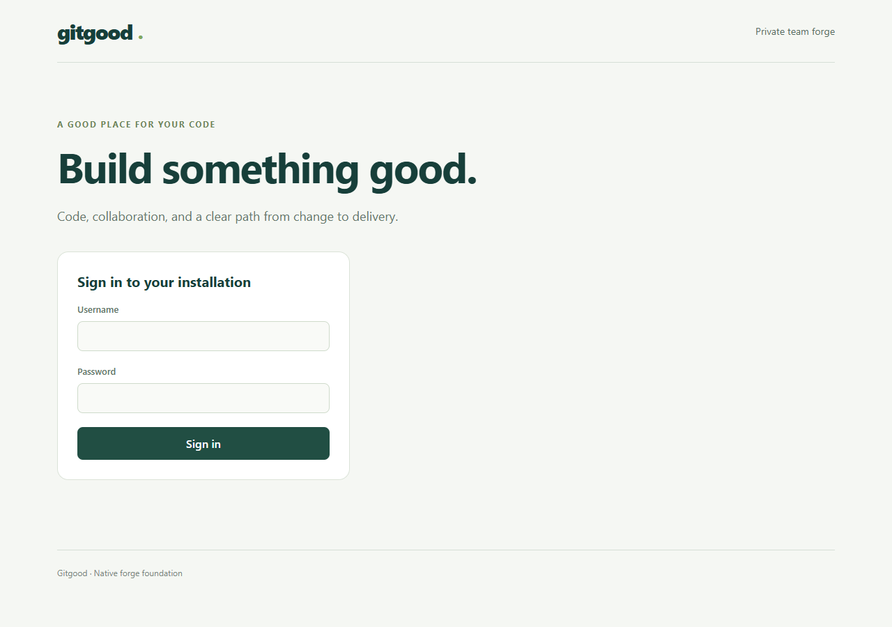
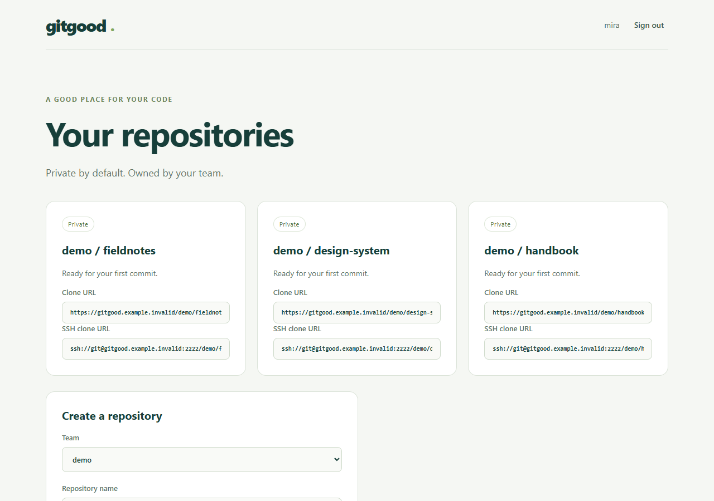
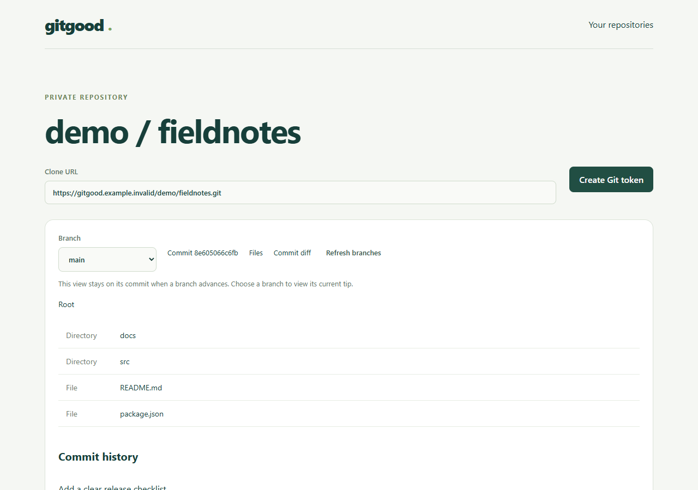
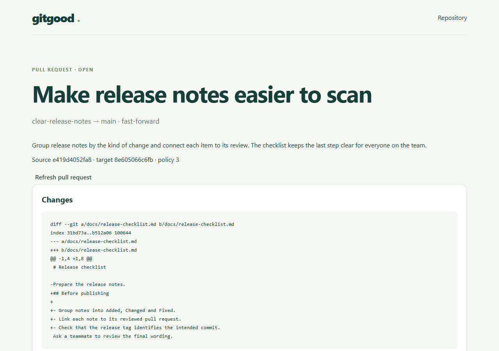
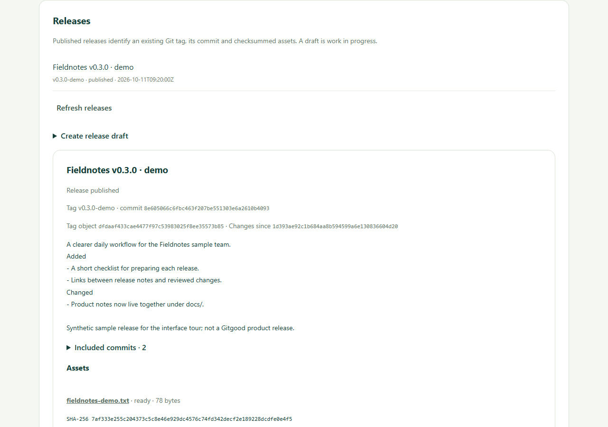

# See the Gitgood interface

[Repository home](../README.md) · [Documentation](README.md) · [Run locally](DEVELOPMENT.md) · [Progress](STATUS.md)

Take a one-minute tour of the development interface: sign in, find a private repository, read its code, review a change, and see its releases.

These images are browser captures of Gitgood's actual React screens, using synthetic API responses and example data. They show the interface as implemented, not a design mockup. They do not demonstrate backend behavior or establish journey acceptance or a product release. [Capture provenance](media/web/capture.json) records the source identity, capture time and file hashes; the [progress snapshot](STATUS.md) explains the separate acceptance state.

## Watch the walkthrough


[Play or download the browser video](media/web/walkthrough.webm) · [Read the ASCII walkthrough](media/web/walkthrough.txt) · [Download the ASCII animation](media/web/walkthrough.cast)

The GIF is a five-screen slideshow. The video records the browser moving through those screens. The ASCII companion uses text from the captured screens; it is not a terminal session or a recording of Git commands. Play the `.cast` file with an asciicast v2 player, or read the text version without installing anything.

## Where everything lives

This navigation map describes the current interface. Repository and review screens contain sections on long, scrolling pages; the map does not imply a tabbed interface.

```text
Sign in
  |
  v
Your repositories
  |
  +-- Open a repository
        |
        +-- Clone addresses, files and commit history
        |     +-- Open a file or commit diff
        |
        +-- Pull requests
        |     +-- Open a review page
        |           +-- Changes
        |           +-- Conversation and reviews
        |           +-- Checks and merge
        |
        +-- Releases (scroll down the repository page)
```

## 1. Sign in

Use the account for your installation. The home screen changes to your repository list after sign-in.



## 2. Find a repository

Private repository cards show their team, name and clone addresses. Open a repository to read its contents; repository creation is available from the same home page.



## 3. Read code

The repository page brings together clone addresses, files and commit history. Select a file to read it. Select a commit, then choose Commit diff to inspect its changes.



## 4. Review a change

Open a pull request from the repository page. Its review page shows the proposed changes, discussion and review controls, followed by checks and merge. These are sections of one page.



## 5. See releases

Scroll to Releases on the repository page. Release records connect a version to a Git tag, commit and assets; the interface distinguishes published records from drafts.



## Try it and keep the tour current

Follow the [development guide](DEVELOPMENT.md) to use the interface with a local forge and disposable accounts.

To refresh this tour, use the pinned Node version and Python 3.12 or later. From `apps/web`, install the web dependencies, Chromium and the small image-conversion dependency once, then run the capture:

```bash
npm ci
npx playwright install chromium
python3 -m pip install -r tour/requirements.txt
npm run tour
```

On Windows, use `python` for the pip command. `GITGOOD_TOUR_PYTHON` can select another Python executable, and `GITGOOD_BROWSER_CHANNEL=msedge` can use an installed Edge instead of downloading Chromium; run `npx playwright install ffmpeg` for video support in that case. Set those variables using your shell's syntax.

The capture tool starts its own loopback Vite server on an available port, supplies synthetic API data and closes its browser/server when finished. It needs no running forge or database. Temporary profiles and logs stay in ignored `.gitgood/` storage. It blocks external browser requests and rejects API writes other than the synthetic sign-in.

Review every image and the animation after UI changes, and commit the generated media and `capture.json` together. Keep credentials and customer data out of tour fixtures. Then run `npm run generate` and `npm run check` from the repository root. The check compares frontend and capture-source hashes with the media inventory, so changed routes, stale screenshots or missing recordings fail explicitly.
