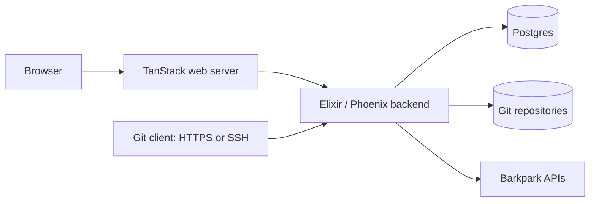

# Architecture and ownership

[Documentation home](README.md) · [Codebase guide](CODEBASE.md) · [Architecture decisions](decisions/README.md)

Gitgood consists of one modular Elixir/Phoenix backend and a React/TypeScript application served by TanStack. Postgres stores collaboration records; standard Git stores code. Forgejo is a reference project, not a runtime dependency. [Product scope](../PRODUCT.md) defines what this architecture must deliver.

## How a request moves through the system

The browser handles interaction and drafts. The web server forwards bounded requests to a fixed backend origin. The backend checks the current actor and repository permissions, applies product rules, and runs bounded Git commands. A web session or an external connection cannot bypass those backend checks.

## One owner for each kind of data

| Component | Responsibility |
|---|---|
| Browser and TanStack web | Pages, navigation, drafts, server rendering and request forwarding |
| Elixir/Phoenix backend | Accounts, repository authorization, reviews, checks, merge policy, operation recovery and APIs |
| Standard Git repositories | Code objects, branches, tags and recovery refs |
| Postgres | Users, membership, credentials, collaboration records, operation journals, release assets and native evidence records |
| Barkpark | Its tasks and Papers; Gitgood stores links and revision-specific evidence instead of becoming another editor of those records |
| Deployment tools and host runtime | Artifact installation, supervised execution, persistent stores and recovery procedures |
| Barkpark Cloud integration | The intended provisioning and managed lifecycle path, defined in the [Cloud contract](../deploy/README.md) |

The last row is an integration contract. It does not mean the current checkout is a deployable Cloud application; see the [progress snapshot](STATUS.md) and [deployment experiment](deployment/production.md).

## Identity and access

Gitgood owns local accounts and team membership under the [standalone identity decision](decisions/0002-local-identity.md). Installation bootstrap provisions accounts; team owners manage existing members. Session, Git and check-provider credentials have distinct purposes, and the backend checks current membership for repository access.

Barkpark connections belong to individual Gitgood accounts. The backend encrypts the configured credential, verifies its supported source scope, and checks source access separately from native repository access. A linked task does not give its reader access to either system automatically. See [account connections](implementation/barkpark-accounts.md) and [link records](implementation/barkpark-records.md).

Cloud installation ownership grants no repository role. Broader identity integration remains a separate [D02 decision](decisions/D02.md); normal installed authentication and Git operation must not depend on Cloud being reachable.

## Git changes and recovery

Git and Postgres cannot commit one shared transaction. Gitgood records responsibility before a Git side effect, binds the intended change to expected refs and authorization, and retains the observed result. Retries reconcile that original operation instead of assuming a repeated command is safe.

Protected merges check the current policy, review/check results and exact source/target identities. The [collaboration reference](implementation/collaboration.md) explains the transaction markers, interruption cases and recovery checks. These are implementation mechanisms; complete journey acceptance still requires current evidence.

## Installation boundary

Forge and web artifacts carry matching build identities and remain separate from mutable databases, repositories and recovery material. Backup and restoration coordinate those stores and the configuration needed to use them; a database import alone cannot prove recovery. See [offline recovery](implementation/offline-backup.md).

The native service design uses a dedicated Linux installation account, systemd supervision and explicit host/database ownership checks. Its components are under development. The current [application startup](../apps/forge/lib/gitgood/application.ex) calls the profile gate before starting workers, and [the gate](../apps/forge/lib/gitgood/installation_profile.ex) refuses the native profile until the complete startup path is integrated. The [supervision decision](decisions/0018-native-supervision-generations.md) explains the intended boundary.

## Where to go deeper

Use the [codebase guide](CODEBASE.md) to find implementation entry points, the [implementation index](implementation/README.md) for behavior and reproduction, and the [decision index](decisions/README.md) for rationale. Runtime pins and lockfiles define dependencies; the [Git compatibility reference](implementation/git-compatibility.md) defines supported client behavior and exclusions.
